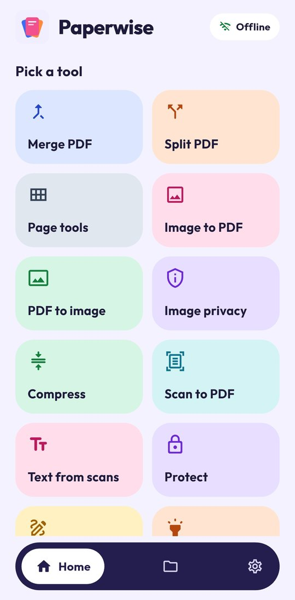
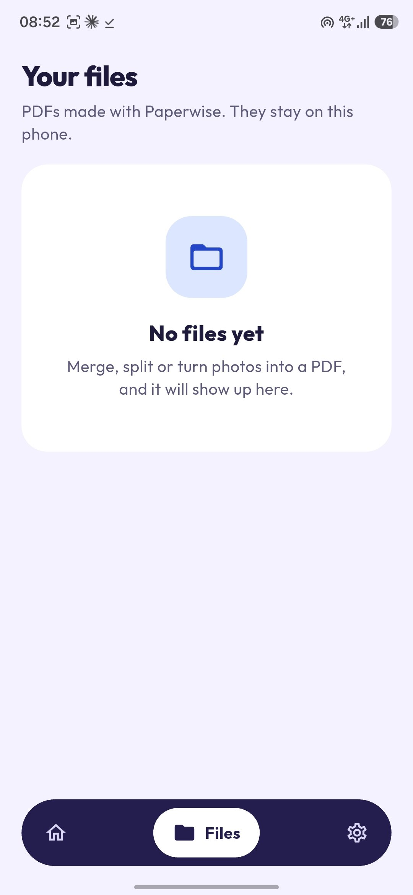
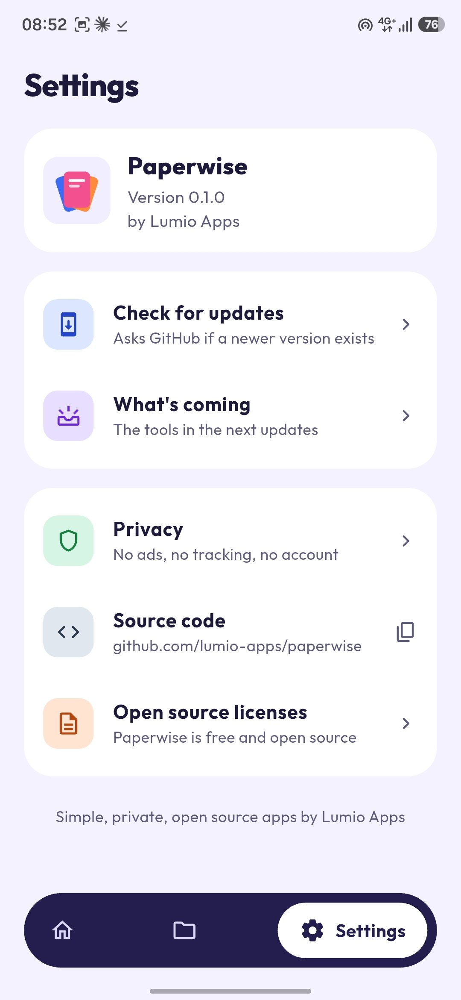

# Paperwise

A private PDF toolkit for Android that works fully offline. Every tool runs on your phone, so your files never leave it. No ads, no tracking, no account.

Made by [Lumio Apps](https://github.com/lumio-apps).

## Download

Get the latest APK from the [Releases page](https://github.com/lumio-apps/paperwise/releases/latest). Requires Android 7.0 or newer.

After that, Paperwise updates itself: open **Settings → Check for updates**.

## Screenshots

<p align="center">
  
  &nbsp;
  
  &nbsp;
  
</p>

## What's in v0.2

- **PDF viewer**: read any PDF inside Paperwise. Zoom, jump to a page, see page thumbnails, and open locked PDFs with their password.
- **Continue reading**: Paperwise remembers the page you stopped on and shows a "Continue reading" card in Your files.
- **Favorites**: star the PDFs you use most and filter them in Your files.
- **Open from other apps**: choose Paperwise when you tap a PDF in your file manager, a chat app or email. Or tap "Open a PDF" in Your files.

## What's in v0.1

- **Merge PDF**: join two or more PDFs and drag them into the order you want.
- **Split PDF**: cut a PDF by page ranges (like `1-4, 5-10`) or make one file per page. A colored page grid shows which pages go into which file.
- **Image to PDF**: pick photos from the gallery or take new ones with the camera. Reorder them, then choose page size (A4, Letter, fit image), orientation and margin.
- **Your files**: every PDF you make is saved in Paperwise. Open, share, save to your phone, rename or delete it.
- **Check for updates**: asks GitHub Releases for a newer version and installs it inside the app. This is the only time Paperwise uses the internet.

## Roadmap

Paperwise grows one small update at a time, one group of features per update.

| Update | Theme | Features |
| --- | --- | --- |
| **v0.1** ✅ released | Foundation | Merge, split, image to PDF (gallery and camera), files list with open, share, save, rename and delete, update checker |
| **v0.2** 🚧 in progress | PDF viewer | Built-in reader with zoom, page jump and thumbnails, continue reading, favorites, open PDFs from other apps |
| **v0.3** | Page tools | Reorder, rotate, delete and extract pages on a visual page grid |
| **v0.4** | Convert and scan | PDF to image (JPG or PNG), scan paper to PDF with the camera, manual crop and filters |
| **v0.5** | Image privacy | Remove EXIF data (location, device info), resize, compress, blur or hide parts of a photo, batch processing |
| **v0.6** | Compress | Light, balanced and strong PDF compression, image quality control, size estimate before saving |
| **v0.7** | Security | Password lock, unlock with the right password, text or image watermark |
| **v0.8** | Edit | Add text, signature, page numbers, header and footer |
| **v0.9** | Markup and search | Highlight, pen and shapes, search for words inside a PDF |
| **v0.10** | Your way | Dark mode, more languages, sort and search files, local backup and restore |
| **v0.11** | OCR | Offline text recognition for scanned pages, searchable PDFs |
| **v1.0** | Ready for stores | Final polish, then F-Droid and Google Play |

## Privacy

- All PDF work happens on the device with [PDFium](https://pdfium.googlesource.com/pdfium/) (through `pdfrx`) and the `pdf` package.
- Files are stored in the app's own folder until you share or save them.
- The internet permission is used only by **Check for updates**.

## Build

```sh
flutter pub get
flutter analyze
flutter build apk --release
```

Pushing a tag like `v0.1.0` builds a signed APK with GitHub Actions and publishes it on the Releases page.

## License

MIT. The bundled Outfit font is under the SIL Open Font License (see `assets/fonts/OFL.txt`).
